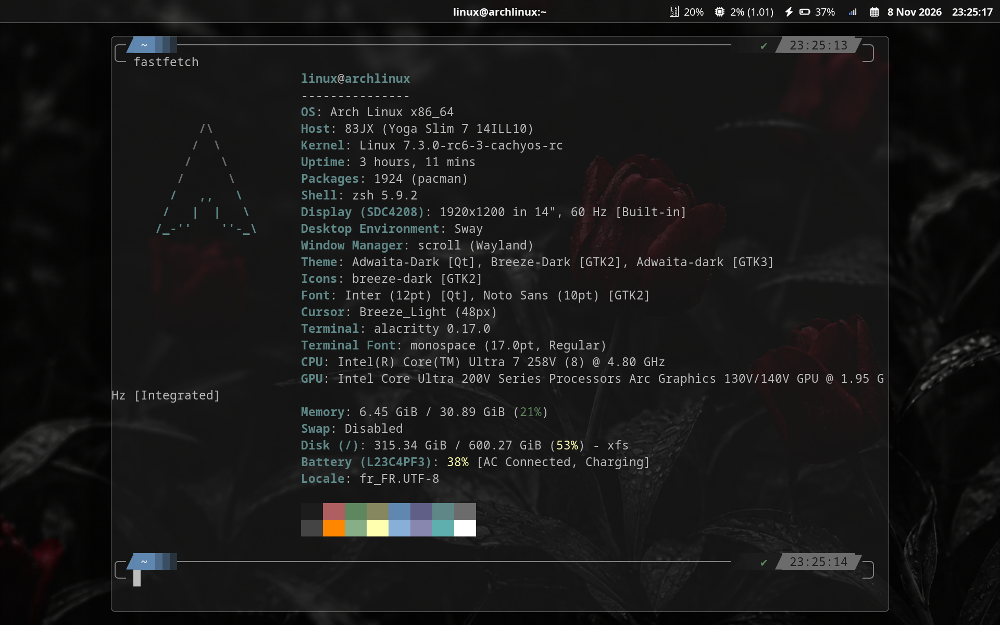
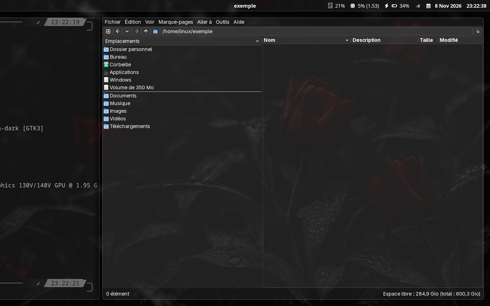
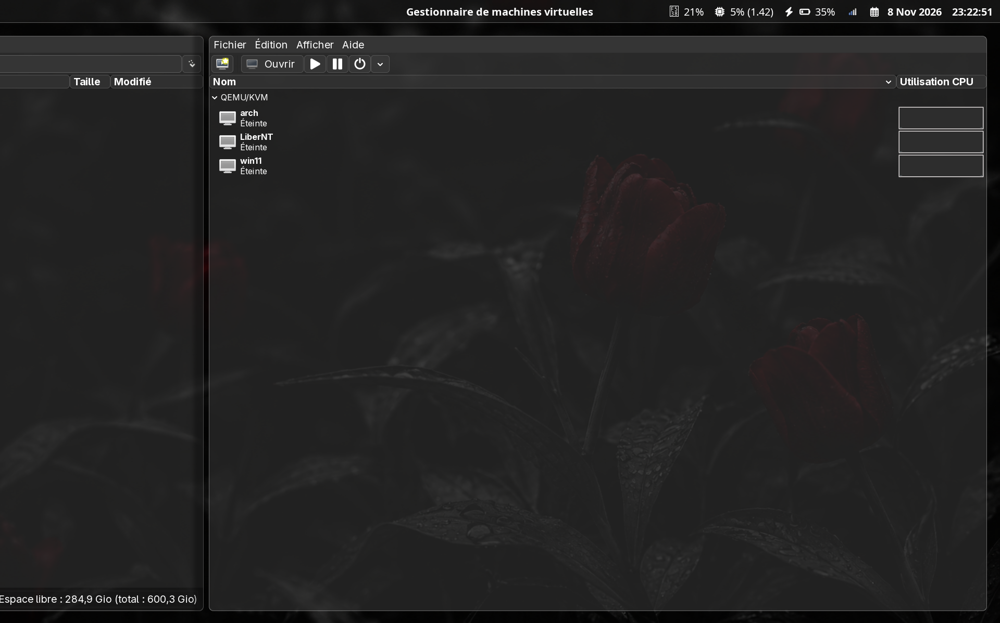

# Dotfiles

Personal desktop setup for Scroll on Wayland, with Alacritty, Rofi, Waybar, and GTK styling.

## Screenshots

Alacritty with the Waybar status bar:



PCManFM with the translucent dark GTK theme:



virt-manager:



## Install

This installer targets Arch Linux and Arch-based distributions. Update the system first, then run it from this directory:

```sh
sudo pacman -Syu
./install.sh
```

The script installs the packages used by the configs and links each config directory into `$XDG_CONFIG_HOME` (defaults to `~/.config`). Existing config directories are moved beside the new links with a `.bak-` timestamp suffix; they are never merged or overwritten.

If Scroll is not already installed, the script uses `yay` or `paru` to install `sway-scroll-git` from the AUR. Install one of those helpers first. To create the links without installing packages, run:

```sh
./install.sh --no-deps
```

Set `XDG_CONFIG_HOME` to use another config directory:

```sh
XDG_CONFIG_HOME="$HOME/.config-test" ./install.sh
```

## Packages

The installer covers the applications and commands referenced by the configs:

| Purpose | Packages |
| --- | --- |
| Desktop | Scroll, Alacritty, Rofi, Waybar, Mako, GTK 3/4, XWayland |
| Apps | Firefox, PCManFM, Code - OSS, virt-manager |
| Capture and media | `swaybg`, `swaylock`, `grim`, `slurp`, `wf-recorder`, `wl-clipboard`, `brightnessctl`, `playerctl`, `libpulse`, `psmisc` |
| System tray | NetworkManager applet, Blueman, BlueZ, polkit-gnome, D-Bus |
| Fonts and paths | JetBrainsMono Nerd Font, Adwaita cursors, `xdg-user-dirs` |

When Scroll is missing, `sway-scroll-git` is built from the AUR and requires `yay` or `paru` plus the `base-devel` tools.

## What's included

| Directory | Contents |
| --- | --- |
| `alacritty/` | Terminal colors, font, and key bindings |
| `gtk-3.0/`, `gtk-4.0/` | Dark GTK settings and CSS |
| `rofi/` | Launcher settings and the `grey-white` theme |
| `scroll/` | Compositor settings and wallpaper |
| `screenshots/` | Images used in this README |
| `waybar/` | Status bar modules and styles |

## Notes

- Alacritty, Rofi, and Waybar use JetBrainsMono Nerd Font. The package is installed by the script.
- Scroll uses the preferred display mode, a French keyboard layout, and the wallpaper in `scroll/wallpaper/`. Change `xkb_layout` in `scroll/config` to use another layout.
- Screenshots and recordings go to the XDG Pictures and Videos folders. `xdg-user-dirs` is installed if needed.
- The network and Bluetooth applets need their system services. Enable NetworkManager or Bluetooth only if you use them; the installer does not change service state.
- Volume shortcuts use `pactl`. They need a PulseAudio-compatible audio server, such as PipeWire Pulse or PulseAudio; the installer provides the client command without replacing your audio server.
- The file manager, browser, editor, and virtual machine manager are launched by Scroll key bindings. Remove or change those bindings in `scroll/config` if you do not use them.
- Arch's `code` package provides Code - OSS. The Microsoft-branded Visual Studio Code build is a separate AUR package ([ArchWiki](https://wiki.archlinux.org/title/Visual_Studio_Code)).

## License

See [LICENSE](LICENSE).
